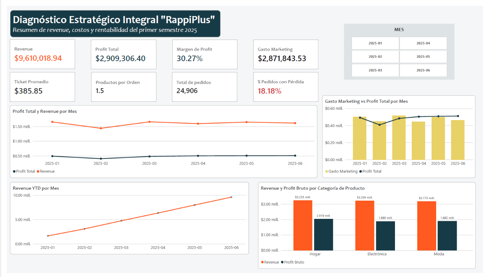
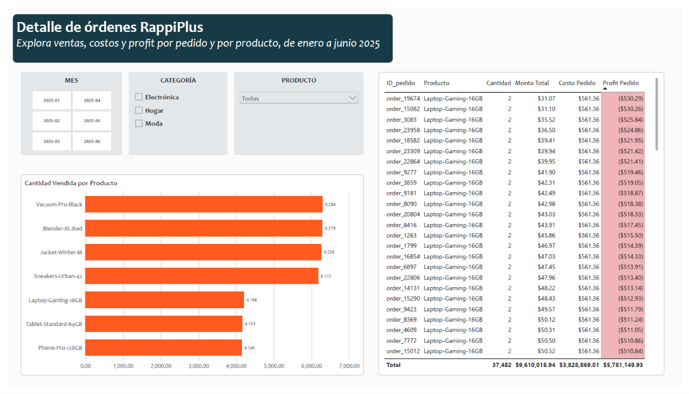
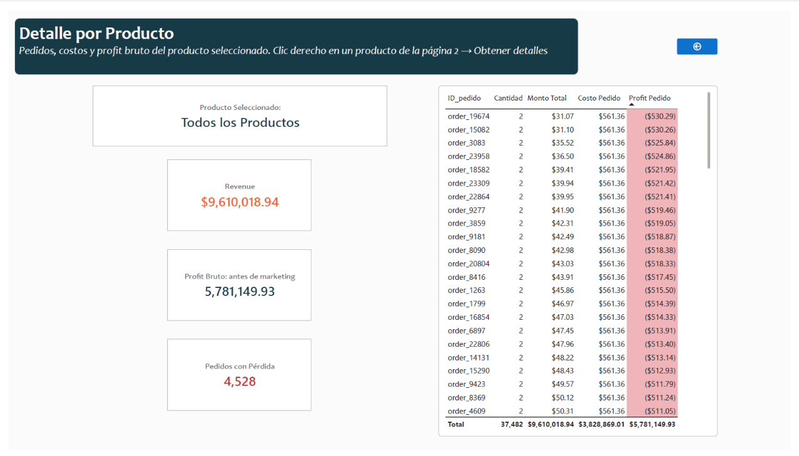
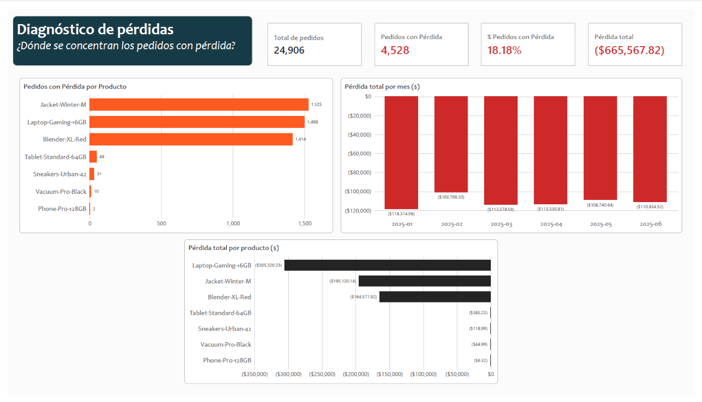

# RappiPlus: de datos a decisiones de negocio

Análisis de punta a punta del servicio de suscripción **RappiPlus**: desde la limpieza de datos hasta un dashboard ejecutivo, pasando por rentabilidad, funnel de compra, retención y un test estadístico.

**Herramientas:** Python (pandas, statsmodels) · SQL · Power BI

---

## 1. Contexto y problema de negocio

RappiPlus es un servicio de suscripción dentro del ecosistema de Rappi, diseñado para aumentar la frecuencia de compra y el valor generado por usuario. El equipo de negocio no tiene claro si el servicio cumple su objetivo, y las dudas son:

- ¿Los usuarios realmente compran más?
- ¿El modelo está generando ganancias?
- ¿Se están perdiendo oportunidades en el proceso de compra?

## 2. Preguntas que responde el proyecto

| Paso | Pregunta clave | Herramienta | Resultado |
|------|----------------|-------------|-----------|
| 1 | ¿Podemos confiar en los datos? | Python | Dataset limpio |
| 2 | ¿Estamos ganando dinero? | Python | KPIs (revenue, costo, profit) |
| 3 | ¿Dónde se pierden los usuarios? | SQL | Funnel de conversión |
| 4 | ¿Los usuarios regresan? | SQL | Retención por cohortes |
| 5 | ¿Los cambios generan impacto? | Python | Test estadístico |
| 6 | ¿Cómo comunicamos todo esto? | Power BI | Dashboard |

## 3. Datos

| Archivo | Contenido |
|---------|-----------|
| `rappiplus_orders_raw.csv` | Pedidos (id_pedido, id_usuario, fecha_hora_pedido, pais, dispositivo, fuente_referencia, nombre_producto, categoria_producto, cantidad, precio_unitario, monto_descuento, monto_total) |
| `rappiplus_catalog.csv` | Catálogo de 7 productos (costo_unitario, proveedor) |
| `rappiplus_marketing_spend.csv` | Gasto de marketing por fecha, país y canal |
| Tabla `events` (SQL) | 120,000 eventos del funnel de compra |
| Tablas `users` y `user_activity` (SQL) | 8,000 usuarios y su actividad a los 7/14/21/28 días |
| `experiment_checkout_ui.csv` | Experimento de interfaz de checkout (10,000 usuarios) |

## 4. Metodología y hallazgos

### Paso 1 · Calidad de datos
Se limpiaron las tres tablas y cada decisión quedó justificada en el notebook.

- **Pedidos:** 25,100 → **24,906** filas (194 eliminadas): duplicados exactos, filas sin producto, cantidades y montos negativos, cantidades atípicas (10,000 y 20,000 unidades) y filas con cantidad, precio y descuento vacíos a la vez.
- **Imputación:** `categoria_producto` recuperada desde el catálogo; `canal` en marketing recuperado desde `id_campaña`.
- **Nulos conservados:** `pais` (1.19%) y `dispositivo` (0.08%) se etiquetaron como "Desconocido" en lugar de eliminarlos, porque 1,997 de 7,640 usuarios compraron desde más de un país (no se puede inferir) y esas filas sí tienen monto.
- **Estandarización:** formato de `pais`, fechas a `datetime`, `cantidad` a entero.
- **Validaciones:** `monto_total = cantidad × precio_unitario − monto_descuento`; tablas consistentes en producto, país y canal.

### Paso 2 · Rentabilidad
| KPI | Valor |
|-----|-------|
| Revenue | 9,610,018.94 |
| Costo de producto | 3,828,869.01 |
| Inversión en marketing | 2,871,843.53 |
| **Profit** | **2,909,306.40** (margen 30.27%) |
| Ticket promedio | 385.85 |
| Cantidad promedio por orden | 1.5 |
| Producto más vendido | Vacuum-Pro-Black (6,284 unidades) |

**Hallazgo clave:** el negocio es rentable en conjunto, pero **18.18% de los pedidos (4,528 de 24,906) se venden por debajo de su costo**. Tres productos concentran el 97.99% de esas pérdidas: Jacket-Winter-M, Laptop-Gaming-16GB y Blender-XL-Red. La pérdida total es de **-665,567.82**, y Laptop-Gaming-16GB aporta el 45.87%. El costo unitario es fijo, pero el precio unitario fluctúa sin explicación en los datos.

### Paso 3 · Funnel de compra (SQL)
`first_visit` 7,796 → `select_item` 7,582 → `add_to_cart` 7,634 → `begin_checkout` 7,208 → `add_payment_info` 6,250 → `purchase` 6,240

- **Conversión global:** 80.04% (6,240 / 7,796).
- **Mayor fuga:** `begin_checkout` → `add_payment_info`, con 13.29% de pérdida (958 usuarios).
- **Anomalía:** `add_to_cart` supera a `select_item`; 401 usuarios (5.25% del carrito) agregan al carrito sin seleccionar producto. Hipótesis: botón de compra directa o llegada desde campañas.

### Paso 4 · Retención por cohortes (SQL)
Cohortes mensuales de enero a mayo. La retención semanal se mantiene **estable entre 40.07% y 43.98%** en todas las cohortes; febrero muestra el valor más alto (semana 3: 43.98%).

### Paso 5 · Test estadístico
Experimento de interfaz de checkout, test z de dos proporciones (dos colas, α = 0.05).

| Grupo | Conversiones | Usuarios | Tasa |
|-------|--------------|----------|------|
| Control | 779 | 4,965 | 15.69% |
| Tratamiento | 820 | 5,035 | 16.29% |

Resultado: **z = -0.813, p = 0.416 → no se rechaza H₀.** No hay evidencia estadística de que el cambio mejore la conversión.

### Paso 6 · Dashboard en Power BI
Cuatro páginas:

1. **Overview Ejecutivo:** KPIs, tendencia mensual y YTD, marketing vs profit, categorías.
2. **Detalle de órdenes:** color condicional por profit, cantidad vendida, filtros por fecha y categoría.
3. **Detalle por Producto:** drill-through.
4. **Diagnóstico de pérdidas:** pedidos con pérdida por producto y pérdida total por mes.






## 5. Recomendaciones

1. **Revisar la política de precios y descuentos** de Jacket-Winter-M, Laptop-Gaming-16GB y Blender-XL-Red, que concentran casi toda la pérdida.
2. **Atender la fuga en el pago** (`begin_checkout` → `add_payment_info`), la mayor del funnel.
3. **No implementar el cambio de interfaz del experimento** sin más evidencia; el resultado no es significativo.
4. **Validar con el equipo** los pedidos con cantidad y monto negativos (¿devoluciones?) y la causa de las cantidades atípicas.

## 6. Limitaciones

- No se verificó si los periodos de pedidos y marketing coinciden.
- El dashboard no incluye desglose por país.
- La causa de la anomalía `add_to_cart` > `select_item` y de la variación de precios no se puede confirmar con estos datos.

## 7. Entregables

- [Notebook de análisis en Python y SQL](Proyecto_Rappi_WA.ipynb)
- [Dashboard en Power BI (.pbix)](Proyecto_Final_Winnie_Ahedo.pbix)
- [Dashboard en PDF](Proyecto_Final_Winnie_Ahedo.pdf)


## 8. Cómo reproducirlo

```bash
pip install pandas numpy statsmodels sqlalchemy jupyter
jupyter notebook "Proyecto_Rappi_WA.ipynb"
```

Las consultas SQL requieren acceso a la base de datos del curso; los resultados ya están guardados en el notebook.

## 9. Autora

**Winnie Ahedo** · [LinkedIn](https://www.linkedin.com/in/winnie-ahedo) · [winnieahedo@gmail.com](mailto:winnieahedo@gmail.com)
